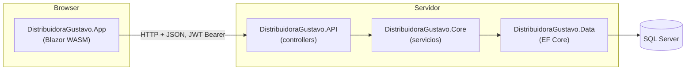
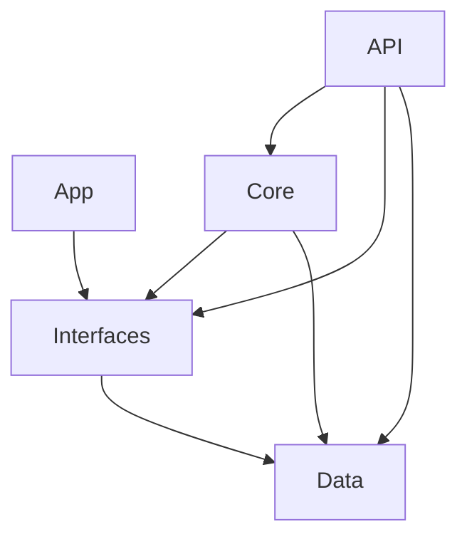

# Arquitectura

[← README](../README.md)

## Vista general

Arquitectura en capas clásica, sin CQRS, MediatR ni repositorios: los servicios usan el `DbContext` directamente.

## Dependencias entre proyectos

| Proyecto | Responsabilidad | Nullable |
|---|---|---|
| `Data` | `DistribuidoraGustavoContext`, entidades EF y migraciones. | enable |
| `Interfaces` | Modelos (DTOs), tipos de resultado (`Results/`), interfaces `I*Service`, `CastEfToModel` (mappers), `LoginRequest/Response`, `ApplicationSettings`, utilidades (`Extensions`, `Log`). | **disable** |
| `Core` | Implementación de los servicios, enum `eTransactionType`, template HTML de la factura. | enable |
| `API` | Host, DI, JWT, CORS, controllers. | enable |
| `App` | Frontend. | **disable** |

Punto a tener presente: **`Interfaces` referencia a `Data`** (porque `CastEfToModel` y `IPriceListService.CalculatePrices` usan entidades EF). Como `App` referencia a `Interfaces`, el frontend arrastra transitivamente las entidades y EF Core al bundle WASM. Ver [deuda-tecnica.md](deuda-tecnica.md#arquitectura).

## Flujo de un request típico

Ejemplo: listar clientes.

1. La página [Clients.razor.cs](../DistribuidoraGustavo.App/Pages/Clients.razor.cs) llama `ApiClient.Send<ListResult<ClientModel>>(ApiRequest.BuildGet("Clients"))`.
2. [ApiClient](../DistribuidoraGustavo.App/Http/ApiClient.cs) lee el JWT de `sessionStorage`, lo agrega como `Authorization: Bearer` y hace el request a `{ApiUrl}Clients`.
3. [ClientsController](../DistribuidoraGustavo.API/Controllers/ClientsController.cs) (hereda `[Authorize]` de `BaseController`) llama a `IClientService.GetAll()` dentro de un `try/catch`.
4. [ClientService](../DistribuidoraGustavo.Core/Services/ClientService.cs) consulta el `DbContext` y convierte entidades a modelos con `CastEfToModel.ToModel`.
5. El controller envuelve el resultado en `ListResult<ClientModel>.Ok(...)`; ante una excepción devuelve `ListResult<ClientModel>.Error(ex)` (también con HTTP 200).
6. El frontend deserializa el mismo tipo `ListResult<ClientModel>` y revisa `.Success`.

## Patrones y convenciones

### Result pattern

Todas las respuestas de la API (salvo la descarga del PDF) son un *result object* definido en [Interfaces/Results](../DistribuidoraGustavo.Interfaces/Results/), serializado como JSON y **compartido por backend y frontend**:

| Tipo | Uso |
|---|---|
| `DTOResult<T>` | Un objeto (`T` debe ser una clase). |
| `ListResult<T>` | Una lista. |
| `BoolResult`, `StringResult` | Valores simples. |

Miembros usados en el código: `Success`, `ResultOk`, `ResultError` (`FriendlyErrorMessage`, `ErrorMessage`, `FullException`), `ResultOperation`, y las fábricas `Ok(value)`, `Error(string)`, `Error(Exception)`. Hay conversión implícita de `T` a `DTOResult<T>` (se usa en `return client.ToModel();`).

Consecuencia importante: **los errores de negocio y las excepciones viajan con HTTP 200**; el frontend nunca debe basarse en el status code, sino en `Success`.

### Capa de servicios

- Una interfaz `I{Entidad}Service` en `Interfaces/Services` y su implementación `{Entidad}Service` en `Core/Services`.
- Se registran como `AddTransient` en [Program.cs](../DistribuidoraGustavo.API/Program.cs#L16). El `DbContext` es *scoped*, así que todos los servicios de un mismo request comparten el mismo contexto (y su change tracker). Esto importa: un `SaveChangesAsync()` en un servicio persiste también lo que otro servicio dejó pendiente.
- Los servicios pueden depender entre sí: `InvoiceService → ITransactionService, IPdfService`; `ProductService → IPriceListService`; `PriceListService → IExcelService`.
- Validaciones de negocio: devuelven `DTOResult.Error("mensaje en español")`. Errores inesperados: se dejan propagar y los atrapa el controller.

### Controllers

- Todos heredan de [BaseController](../DistribuidoraGustavo.API/Controllers/BaseController.cs): `[Authorize]`, `[ApiController]`, `[Route("[controller]")]`. La ruta es el nombre del controller sin prefijo `api/`.
- Cada acción repite el mismo esqueleto: `try { ... return Result.Ok(x); } catch (Exception ex) { Log.Error(ex); return Result.Error(ex); }`.
- `BaseController.UserId` lee el claim `IdUsuario` del JWT.
- Los endpoints de escritura son **upserts por POST**: el id en `0` significa alta, distinto de `0` significa modificación. No se usa PUT.

### Modelos y mapeo

- Las entidades EF nunca salen de la API: se convierten a `*Model` con los métodos de extensión `ToModel()` de [CastEfToModel.cs](../DistribuidoraGustavo.Interfaces/Parsers/CastEfToModel.cs). No hay mapeo inverso; los servicios copian campo a campo del modelo a la entidad.
- No se usa AutoMapper.
- Las fechas salen como `string` ya formateado (`dd/MM/yyyy HH:mm`, UTC−3 fijo) vía `DateToString()`.
- Herencia de modelos: `ProductInvoiceModel` y `PricedProductModel` heredan de `ProductModel`; en el frontend `UIProductModel` hereda de `ProductModel` y agrega `Checked`.

### Frontend

- **Code-behind por herencia**: cada página es `X.razor` + `X.razor.cs`, donde el `.cs` define `class XBase : ComponentBase` y el `.razor` hace `@inherits XBase`. No se usan clases `partial`.
- **Estado de página** en una clase POCO `XState` definida en el mismo `.razor.cs` (ej. `InvoicesState`, `PricesState`).
- **Ruteo por enum**: [Views.cs](../DistribuidoraGustavo.App/Utils/Views.cs) lista las vistas; se navega con `NavigationManager.NavigateTo(Views.X.ToString())`. El nombre del enum debe coincidir (sin distinguir mayúsculas) con la ruta `@page`.
- **Un único punto de acceso HTTP**: `ApiClient` + `ApiRequest`.
- Sin librería de estado global, sin `AuthenticationStateProvider`, sin `EditForm`/validaciones de DataAnnotations.

Detalle en [frontend.md](frontend.md).

### Nomenclatura

- Código en inglés; textos de UI y mensajes de error en español.
- Tablas en plural; tablas puente con guion bajo (`Invoices_Products`, `Products_PriceLists`) que EF mapea a `InvoicesProduct` y `ProductsPriceList`.
- Enums con prefijo `e` (`eTransactionType`).
- Privados con `_camelCase`; namespaces mezclan *file-scoped* y con bloque.

### Fechas y cultura

- Todo se persiste en UTC (`DateTime.UtcNow`, `GETUTCDATE()`).
- La conversión a hora argentina está hardcodeada como `AddHours(-3)` en [Extensions.cs:13](../DistribuidoraGustavo.Interfaces/Shared/Extensions.cs#L13).
- El PDF formatea importes con cultura `es-AR`; el resto de la app usa la cultura por defecto del proceso.
