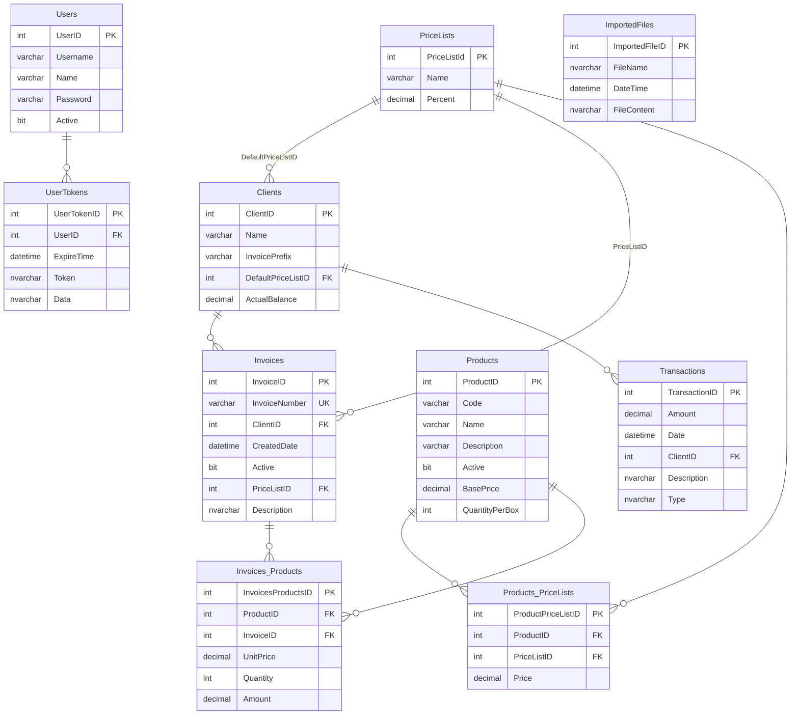

# Base de datos

[← README](../README.md)

SQL Server. El esquema se maneja **code first**: la fuente de verdad son las entidades y el `DbContext` de [DistribuidoraGustavo.Data/EfModels](../DistribuidoraGustavo.Data/EfModels/), y los cambios se aplican con migraciones de EF Core ([Migrations/](../DistribuidoraGustavo.Data/Migrations/)). No hay vistas, stored procedures ni datos semilla.

## Diagrama



## Tablas

| Tabla | Propósito | Detalles relevantes |
|---|---|---|
| `Users` | Usuarios del sistema | `Password` guarda el texto encriptado (reversible). `Username` sin restricción de unicidad. |
| `UserTokens` | Tokens de un solo uso | Hoy solo para descarga de PDF: `Data` = id de factura. |
| `Clients` | Clientes | `InvoicePrefix` identifica las facturas del cliente (unicidad validada solo en código). `ActualBalance` es el saldo de cuenta corriente desnormalizado. |
| `PriceLists` | Listas de precios | `Name` máx. 10 caracteres. `Percent` es el recargo sobre el precio base. |
| `Products` | Productos | `Code` sin índice único (validado en código). `Active` para baja lógica. |
| `Products_PriceLists` | Precio de cada producto en cada lista | Valor **calculado y persistido**. Sin unicidad sobre (`ProductID`, `PriceListID`). |
| `Invoices` | Cabecera de factura | `InvoiceNumber` único global, formato `{prefijo}-{n}`. `Active` para baja lógica (default `0` en la base; el código siempre inserta `true`). |
| `Invoices_Products` | Ítems de factura | Guarda `UnitPrice`, `Quantity` y `Amount` al momento de facturar. |
| `Transactions` | Movimientos de cuenta corriente | `Type` = `"Invoice"` o `"Payment"` (nombre del enum). Las de factura se vinculan por `Description = InvoiceNumber`, sin FK. Pagos con importe negativo. |
| `ImportedFiles` | Respaldo de los Excel importados | `FileContent` en base64. Se conservan los últimos ~5. |

Todos los importes son `DECIMAL(10,2)`: el máximo representable es 99.999.999,99.

Fechas en UTC (`GETUTCDATE()` como default en `Invoices.CreatedDate` y `Transactions.Date`).

## Capa EF Core

- Las entidades de [EfModels/](../DistribuidoraGustavo.Data/EfModels/) y el mapeo en [DistribuidoraGustavoContext.cs](../DistribuidoraGustavo.Data/EfModels/DistribuidoraGustavoContext.cs) se **mantienen a mano**. Nacieron de un scaffold (de ahí el estilo y las clases `partial`), pero ya no se regeneran.
- Nombres de entidades: `Invoices_Products` → `InvoicesProduct`, `Products_PriceLists` → `ProductsPriceList`.
- Los nombres de columna terminados en `ID` se fijan con `HasColumnName` para respetar el esquema original.
- No hay lazy loading: las navegaciones se cargan con `Include` explícito.
- Las FKs están configuradas con `DeleteBehavior.ClientSetNull` (sin borrado en cascada).

## Herramientas

`dotnet-ef` está declarado como herramienta local en [dotnet-tools.json](../dotnet-tools.json). Después de clonar:

```bash
dotnet tool restore
```

Los comandos se ejecutan desde la raíz del repo, con `Data` como proyecto de migraciones y `API` como proyecto de inicio (de ahí sale la connection string, en entorno `Development`).

## Crear la base local desde cero

```bash
dotnet ef database update --project DistribuidoraGustavo.Data --startup-project DistribuidoraGustavo.API
```

Crea la base si no existe y aplica todas las migraciones. Después hay que cargar a mano al menos una lista de precios y un usuario (ver [README](../README.md#cómo-levantarlo-en-local)).

## Cómo cambiar el esquema

1. Editar la entidad en `EfModels/` y, si hace falta, su configuración en `OnModelCreating` (tipo de columna, longitud, default, nombre).
2. Generar la migración:
   ```bash
   dotnet ef migrations add NombreDelCambio --project DistribuidoraGustavo.Data --startup-project DistribuidoraGustavo.API
   ```
3. **Revisar el archivo generado** en `Migrations/`: que haga solo lo esperado y que no pierda datos (un rename mal detectado se genera como borrar y crear la columna).
4. Aplicarla en local con `dotnet ef database update` (mismo comando de arriba).
5. Actualizar `CastEfToModel`, los `*Model` y los servicios que usen el campo nuevo.

Una migración ya aplicada en alguna base no se edita: se corrige con una migración nueva. Si todavía no se aplicó en ningún lado, se puede descartar con `dotnet ef migrations remove`.

## Desplegar cambios

Generar un script idempotente (se puede correr contra cualquier base, aplica solo lo que falte) y ejecutarlo a mano:

```bash
dotnet ef migrations script --idempotent --project DistribuidoraGustavo.Data --startup-project DistribuidoraGustavo.API -o migracion.sql
```

La API no aplica migraciones al arrancar.

## Adoptar una base que ya existe

Una base creada con el proyecto SSDT anterior (producción, o una local vieja) ya tiene las tablas, así que la migración inicial no debe ejecutarse: hay que marcarla como aplicada. Para eso está [sql/adoptar-base-existente.sql](sql/adoptar-base-existente.sql), que se corre **una sola vez por base**:

- crea `__EFMigrationsHistory` e inserta la fila de `InitialCreate`;
- crea los índices sobre claves foráneas, que la migración inicial incluye y el esquema anterior no tenía.

Diferencias que quedan entre una base adoptada y una creada desde cero, a tener en cuenta si una migración futura toca esos objetos:

- **Nombres de claves primarias.** El modelo asume `PK_Clients`, `PK_Invoices`, etc.; en una base adoptada tienen nombres autogenerados (`PK__Clients__...`).
- **Unicidad de `Invoices.InvoiceNumber`.** El modelo asume un índice único llamado `UQ_Invoices_InvoiceNumber`; en una base adoptada es una restricción `UNIQUE` con nombre autogenerado.

Mientras ninguna migración modifique una clave primaria o esa unicidad, la diferencia no tiene efecto. La migración inicial se validó contra las definiciones del proyecto SSDT (columnas, tipos, nulabilidad, defaults y claves foráneas), no contra la base de producción real: conviene comparar antes del primer despliegue.
