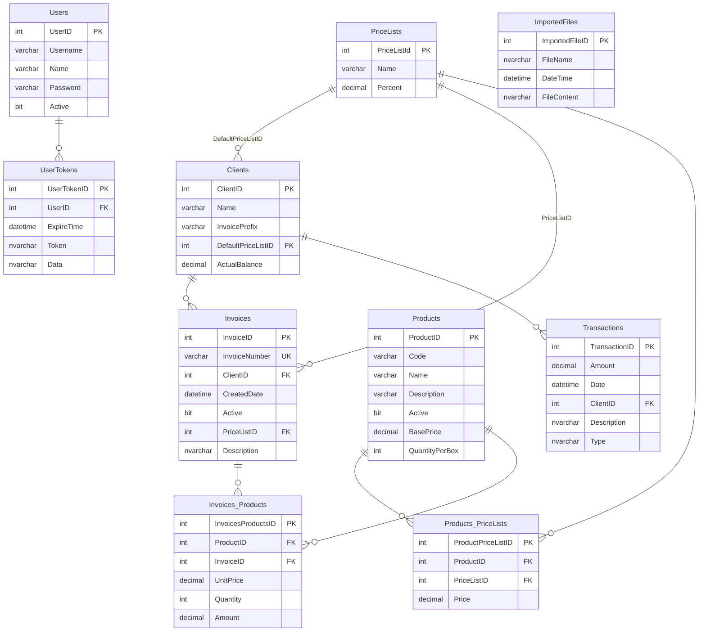

# Base de datos

[← README](../README.md)

SQL Server. El esquema se define en el proyecto SSDT [DistribuidoraGustavo.SQL](../DistribuidoraGustavo.SQL/) (target: Azure SQL V12), con un archivo por tabla en `Tables/`. No hay vistas, stored procedures, índices adicionales, scripts post-deploy ni datos semilla.

## Diagrama



## Tablas

| Tabla | Propósito | Detalles relevantes |
|---|---|---|
| `Users` | Usuarios del sistema | `Password` guarda el texto encriptado (reversible). `Username` sin restricción de unicidad. |
| `UserTokens` | Tokens de un solo uso | Hoy solo para descarga de PDF: `Data` = id de factura. |
| `Clients` | Clientes | `InvoicePrefix` identifica las facturas del cliente (unicidad validada solo en código). `ActualBalance` es el saldo de cuenta corriente desnormalizado. |
| `PriceLists` | Listas de precios | `Name` máx. 10 caracteres. `Percent` es el recargo sobre el precio base. |
| `Products` | Productos | `Code` sin índice único (validado en código). `Active` para baja lógica. |
| `Products_PriceLists` | Precio de cada producto en cada lista | Valor **calculado y persistido**. Sin unicidad sobre (`ProductID`, `PriceListID`). |
| `Invoices` | Cabecera de factura | `InvoiceNumber` único global, formato `{prefijo}-{n}`. `Active` para baja lógica (default `0` en SQL; el código siempre inserta `true`). |
| `Invoices_Products` | Ítems de factura | Guarda `UnitPrice`, `Quantity` y `Amount` al momento de facturar. |
| `Transactions` | Movimientos de cuenta corriente | `Type` = `"Invoice"` o `"Payment"` (nombre del enum). Las de factura se vinculan por `Description = InvoiceNumber`, sin FK. Pagos con importe negativo. |
| `ImportedFiles` | Respaldo de los Excel importados | `FileContent` en base64. Se conservan los últimos ~5. |

Todos los importes son `DECIMAL(10,2)`: el máximo representable es 99.999.999,99.

Fechas en UTC (`GETUTCDATE()` como default en `Invoices.CreatedDate` y `Transactions.Date`).

## Capa EF Core

- [DistribuidoraGustavoContext.cs](../DistribuidoraGustavo.Data/EfModels/DistribuidoraGustavoContext.cs) y las entidades de [EfModels/](../DistribuidoraGustavo.Data/EfModels/) son **código generado** por `Scaffold-DbContext`. No editarlos a mano: se pisan en el próximo scaffold. Para extender, usar `partial class` en otro archivo (el contexto ya expone `OnModelCreatingPartial`).
- Nombres de entidades: `Invoices_Products` → `InvoicesProduct`, `Products_PriceLists` → `ProductsPriceList`.
- No hay lazy loading: las navegaciones se cargan con `Include` explícito.
- Las FKs están configuradas con `DeleteBehavior.ClientSetNull` (sin borrado en cascada).
- No se usan migraciones de EF.

## Cómo cambiar el esquema

1. Editar o agregar el `.sql` en [DistribuidoraGustavo.SQL/Tables/](../DistribuidoraGustavo.SQL/Tables/). Si es una tabla nueva, agregar el `<Build Include="Tables\X.sql" />` en el [.sqlproj](../DistribuidoraGustavo.SQL/DistribuidoraGustavo.SQL.sqlproj).
2. Publicar el proyecto SQL contra la base local (perfil `Local...publish.xml`).
3. Regenerar los modelos EF con el comando de [scaffold.txt](../scaffold.txt), desde la Package Manager Console con `DistribuidoraGustavo.Data` como proyecto por defecto:
   ```powershell
   Scaffold-DbContext 'Data Source=.\sqlexpress01;Initial Catalog=DistribuidoraGustavo; Integrated Security=SSPI;Encrypt=false' Microsoft.EntityFrameworkCore.SqlServer -o EfModels/ -f
   ```
4. Actualizar `CastEfToModel`, los `*Model` y los servicios que usen el campo nuevo.
5. Publicar el proyecto SQL contra producción (el perfil de producción no está en el repo).

Si no se puede ejecutar el scaffold (por ejemplo, sin acceso a la base), la alternativa es editar a mano la entidad y el `OnModelCreating` imitando exactamente el estilo generado, para que el próximo scaffold no produzca diferencias.

## Diferencias entre el SQL y el scaffold

El contexto scaffoldeado no coincide al 100% con los `.sql`, lo que indica que se generó contra una base ligeramente distinta:

- `Clients.ClientID` está mapeado como columna `CLientId` ([línea 46](../DistribuidoraGustavo.Data/EfModels/DistribuidoraGustavoContext.cs#L46)). Funciona porque SQL Server no distingue mayúsculas en identificadores con la collation usada.
- Varias PK tienen nombres `PK__tmp_ms_x__...`, típicos de tablas reconstruidas por SSDT.
